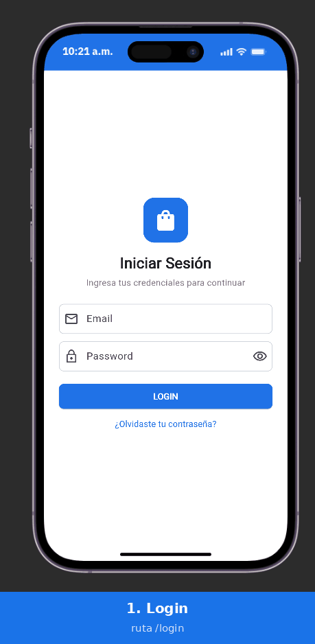
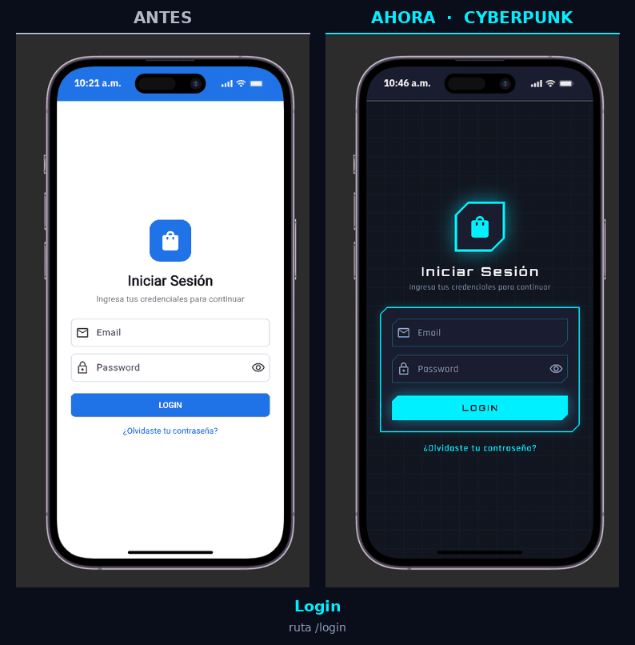
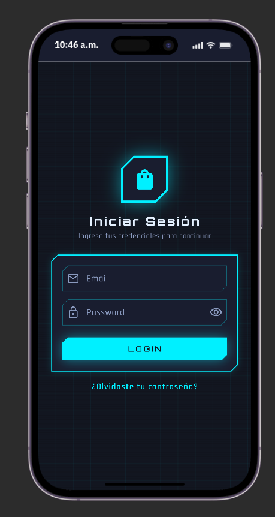
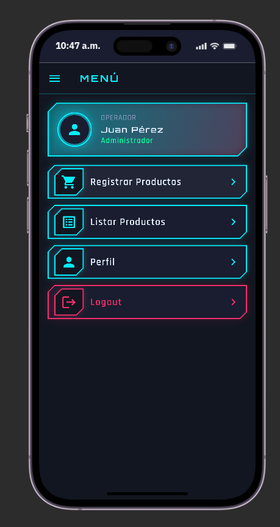
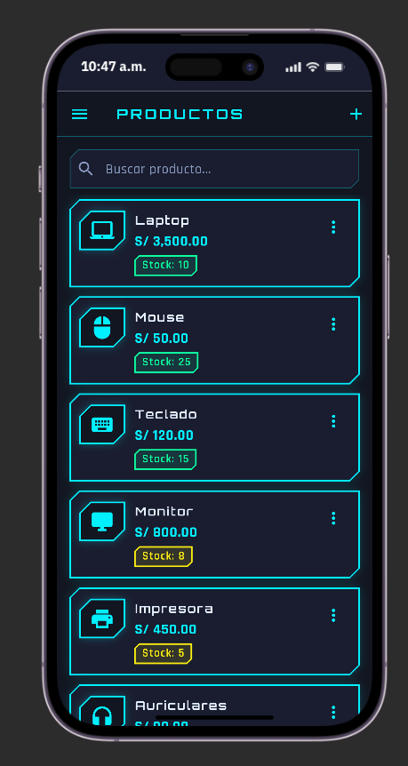
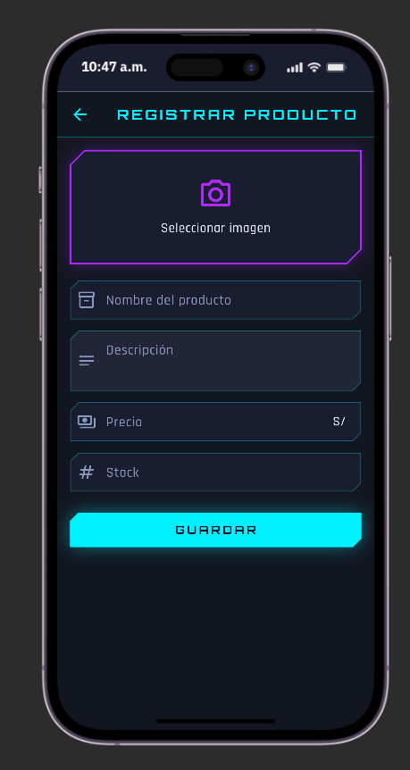
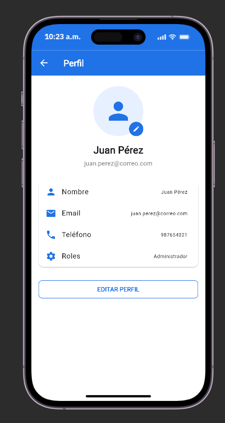
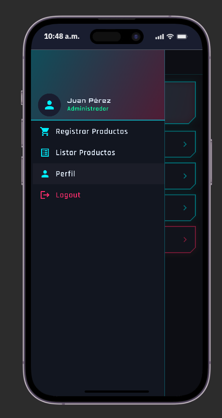

# Laboratorio 7 y 8 – Flutter: navegación y diseño

App de demostración con **5 pantallas** (Login, Menú, Listar productos, Registrar producto y Perfil).
El alcance es solo **front y navegación**: no hay base de datos ni lógica de negocio.

## Capacidades trabajadas

| Capacidad | Dónde verla |
|---|---|
| **ListView** | `lib/screens/menu_screen.dart`, `lib/screens/product_list_screen.dart` (`ListView.builder`), `lib/screens/profile_screen.dart` y `lib/screens/product_form_screen.dart` (`ListView` con hijos fijos) |
| **ListTile** | Filas del menú, de productos, del perfil y del Drawer |
| **Listas y Mapas** | `lib/data/app_data.dart` (`List<Map<String, dynamic>>` y `Map<String, String>`), `lib/models/product.dart` (`Product.fromMap`) |
| **Rutas** | `lib/routes/app_routes.dart` (nombres), `lib/routes/app_router.dart` (tabla), `Navigator.pushNamed / pushReplacementNamed / pushNamedAndRemoveUntil / pop` |
| **Tema global** | `lib/theme/app_theme.dart` → `MaterialApp(theme: AppTheme.dark)` (estética cyberpunk: ColorScheme, textTheme, card/listTile/input/botones/snackBar/divider y `pageTransitionsTheme`) |
| **Card** | Opciones del menú, productos y datos del perfil |

Los fragmentos que no se vieron en clase están comentados en el código con la etiqueta **`[NUEVO]`**.

## Diseño cyberpunk

- Fondo `#0A0E1A`, superficies `#12172B`; neón cian `#00F0FF`, magenta `#FF2A6D`, violeta `#B026FF`, amarillo `#FCEE0A` y verde `#05FFA1`.
- Esquinas cortadas (`BeveledRectangleBorder` / `CutInputBorder`) y brillo con `BoxShadow` (`glow_decoration.dart`).
- Etiqueta de stock: magenta si es 0, amarillo si es menor a 10, verde neón en otro caso.
- Todos los colores y estilos salen de `AppTheme`; las pantallas no usan colores sueltos.

## Flujo de navegación

```
Login ──(LOGIN)──▶ Menú ──▶ Registrar Productos
                    │  ├──▶ Listar Productos ──(+ / Editar)──▶ Registrar Producto
                    │  ├──▶ Perfil
                    └──┴──▶ Logout ──▶ Login (limpia el historial)
```

## Estructura

```
lib/
├── main.dart
├── data/        app_data.dart          (listas y mapas de ejemplo)
├── models/      product.dart
├── routes/      app_routes.dart, app_router.dart
├── screens/     login, menu, product_list, product_form, profile
├── theme/       app_theme.dart (paleta, fuentes, componentes), cut_input_border.dart, cyber_page_transitions.dart
└── widgets/     app_drawer.dart, demo_message.dart, glow_decoration.dart, neon_card.dart,
                 neon_icon_frame.dart, neon_button.dart, neon_text_field.dart, stock_badge.dart, grid_background.dart

assets/fonts/    Orbitron (títulos) y Rajdhani (cuerpo), licencia OFL
```

## Cómo ejecutar

Este repositorio contiene `pubspec.yaml` y `lib/`. La primera vez, genera las carpetas de plataforma:

```bash
flutter create . --platforms=android
flutter pub get
flutter run
```

Pruebas: `flutter test`

## Entrega

- Repositorio: https://github.com/jort-tec-snt/damp-lab7_8

## Demostración



## Antes y después



| Login | Menú | Listar productos |
|:---:|:---:|:---:|
|  |  |  |
| `/login` | `/menu` | `/products` |

| Registrar producto | Perfil | Menú lateral |
|:---:|:---:|:---:|
|  |  |  |
| `/products/register` | `/profile` | Drawer |
